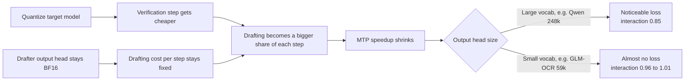
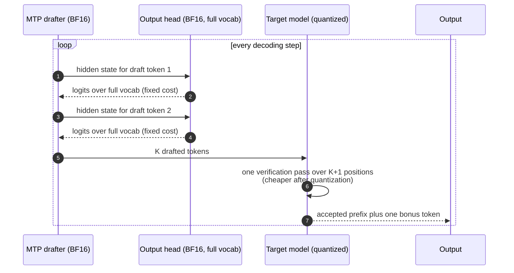
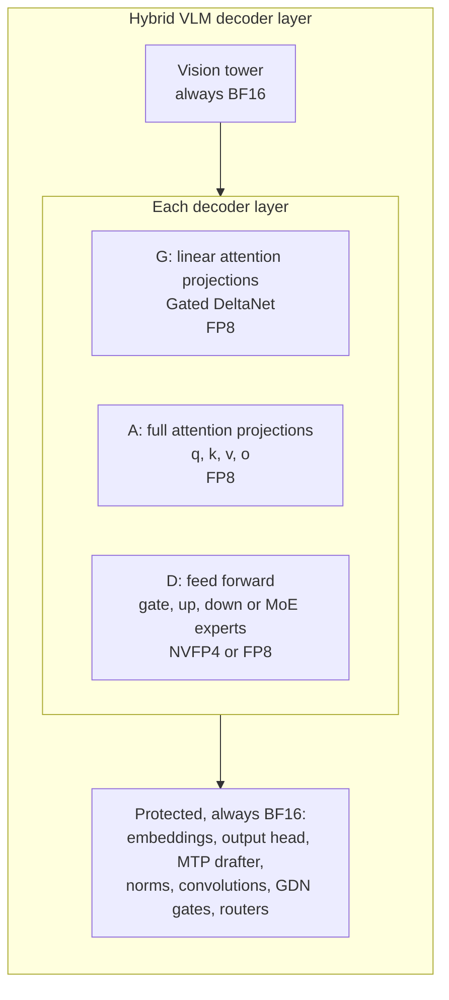
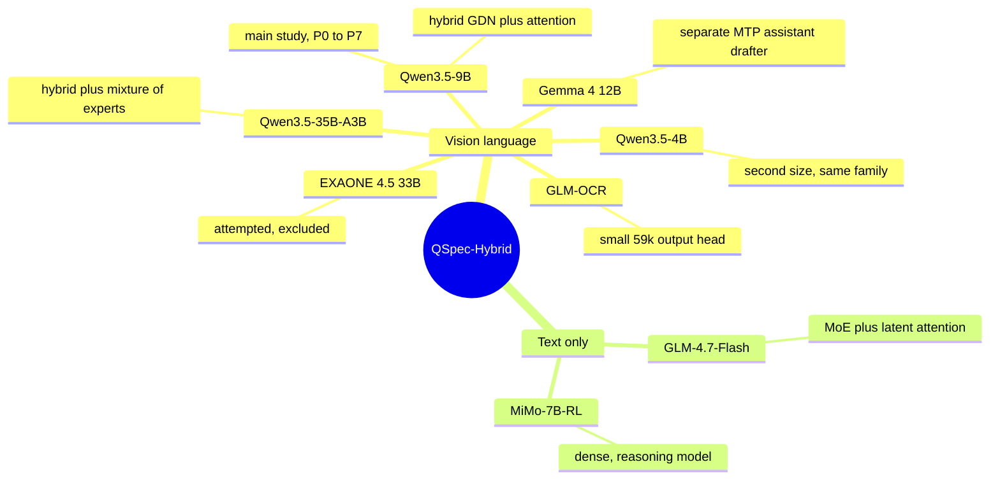
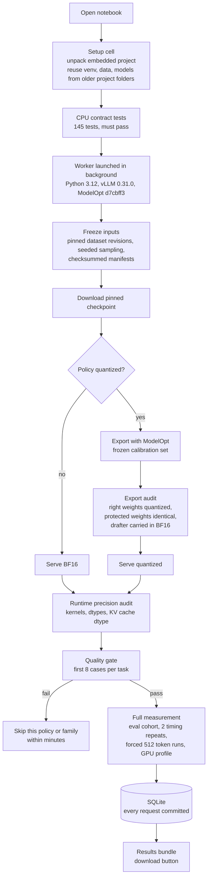
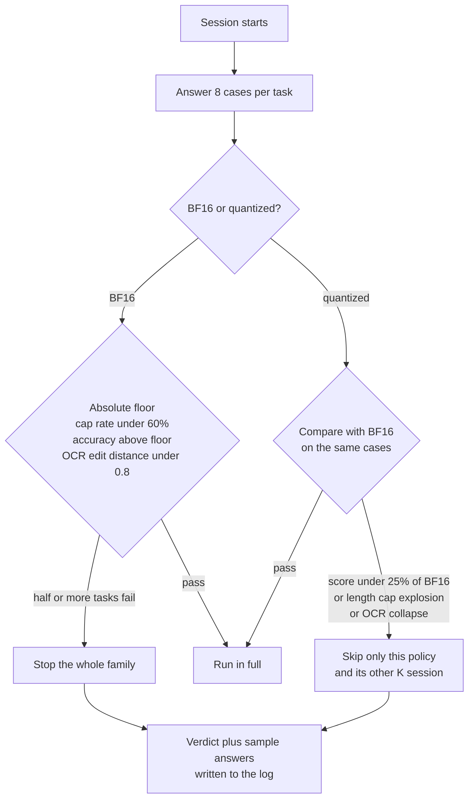
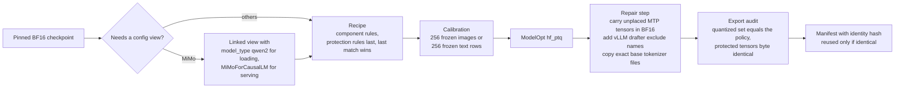
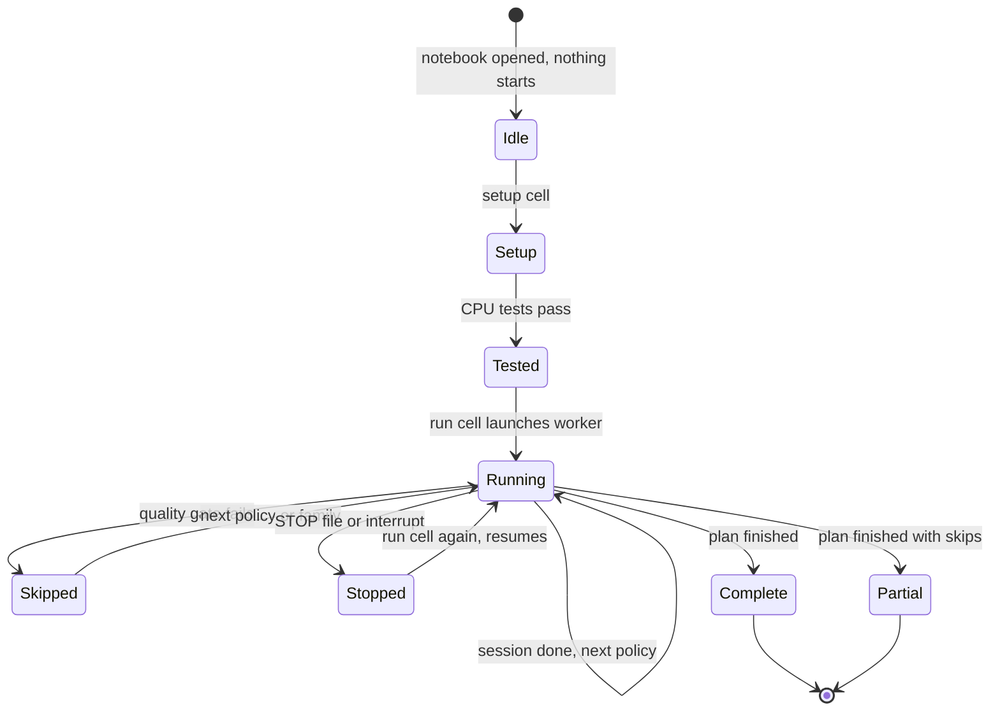
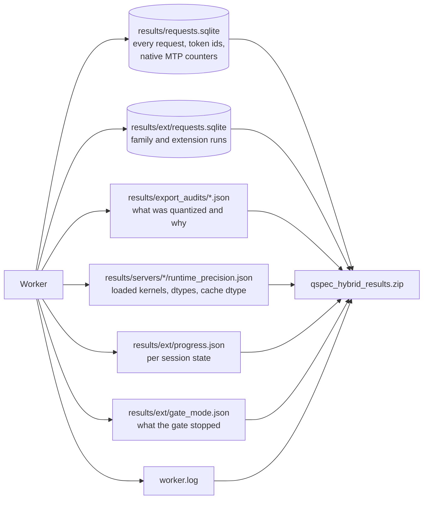

# QSpec-Hybrid

**Does quantization quietly eat the speedup you get from speculative decoding?**

QSpec-Hybrid is a reproducible research harness that answers that question on real models, on real hardware, with every request saved. It quantizes one *component* of a model at a time (the feed forward network, the attention projections, the linear attention projections), serves each variant with and without the model's **native multi token prediction (MTP)** drafter, and measures what actually happens to latency, acceptance and quality.

The headline finding: quantization and MTP do not stack cleanly. Shrinking the target model makes each verification step cheaper, but the drafter's cost per step does not shrink with it. On Qwen3.5-9B the drafting share of each step rises from 18% to 29% under full quantization, and the MTP speedup falls from 2.05x to 1.82x. The culprit is the BF16 output head the drafter runs once per drafted token. Models with a small output head (GLM-OCR, 59k vocabulary) keep almost all of their MTP gain. Models with a big one lose part of it.



---

## The idea in one picture

A speculative decoding step has two parts. The **drafter** guesses the next K tokens. The **target** checks all of them in one forward pass and keeps the longest correct prefix. Quantization speeds up the target. It does nothing for the drafter, whose dominant cost here is a full vocabulary output projection in BF16.



The latency model behind the analysis is deliberately simple:

```
T  =  TTFT  +  (n - 1) * c / a

TTFT   time to first token (prefill plus vision)
n      output tokens
c      cost of one decoding step
a      mean tokens accepted per step
```

It predicts measured latency with 3.5% error under leave-one-task-out and 1.9% across the output length sweep. Splitting `c` into a verification part and a fixed drafting part (`s - c` of about 3.6 ms on Qwen3.5-9B) is what explains the interaction.

---

## What gets quantized

Every model is cut into three component groups. Each policy quantizes a subset and leaves everything else bit for bit identical to the BF16 checkpoint.



| Policy | Groups | Formats |
|---|---|---|
| P0 | none | BF16 reference |
| P1 | D | NVFP4 W4A4 |
| P2 | A | FP8 W8A8 |
| P3 | G | FP8 W8A8 |
| P4 | D + A | NVFP4 + FP8 |
| P5 | D + G | NVFP4 + FP8 |
| P6 | A + G | FP8 |
| P7 | D + A + G | NVFP4 + FP8 |

Every policy runs twice: plain autoregressive decoding (K=0) and native MTP (K=2). The KV cache stays BF16 everywhere, and that is audited at runtime, not assumed.

---

## Models covered



| Family | Mode | Tasks | Policies | Status |
|---|---|---|---|---|
| Qwen3.5-9B | `full`, `extend` | TextVQA, ChartQA, MMStar, OmniDocBench OCR | P0 to P7 | complete |
| Qwen3.5-4B | `extend` | same four | P0, P1, P7 | complete |
| GLM-OCR | `fam_glmocr` | OCR only, prompt `Text Recognition:` | O0, O1, OF1, O4 | complete |
| Gemma 4 12B | `fam_gemma` | same four | G0, GF1, GF4 | BF16 complete, quantized rerun pending |
| Qwen3.5-35B-A3B | `fam_qwen35moe` | same four | M0, M1, MF1, M7 | ready to run |
| GLM-4.7-Flash | `fam_glm47` | GSM8K, CNN/DailyMail | L0, L1, LF1, L4 | BF16 verified on GPU |
| MiMo-7B-RL | `fam_mimo` | GSM8K, CNN/DailyMail | N0, N1, NF1, N4 | ready to run |
| EXAONE 4.5 33B | `fam_exaone` | same four | X0, X1, XF1 | excluded, BF16 output incoherent in vLLM 0.31 |

Policy names follow one pattern: the letter is the family, `0` is BF16, `1` is D in NVFP4, `F1` is D in FP8, `4` adds attention, `7` adds attention and linear attention.

---

## How a run works end to end



### The quality gate

Long GPU runs on a broken model are the most expensive failure there is. Every session first answers 8 cases per task and is judged before anything long starts.



The gate caught EXAONE in 15 minutes (it had burned 6 hours before the gate existed) and caught both broken Gemma quantized exports within minutes each.

### Export and audit pipeline



A few repairs exist because the real world is messy:

- **Drafter naming.** vLLM names some drafters differently from the checkpoint (GLM-OCR `model.layers.16`, GLM-4.7-Flash `model.layers.47`, MiMo `model.layers.36`). The export adds exclude rules under the vLLM names, or vLLM would try to load a BF16 drafter as low precision.
- **Routers.** Mixture of experts routers stay BF16 and are excluded explicitly.
- **Tokenizer files.** ModelOpt skips files whose Hugging Face cache link points outside the snapshot folder. Every export now gets an exact copy of the base tokenizer.
- **MoE kernels.** On SM120, vLLM's automatic MoE choice compiles a FlashInfer kernel at startup and that compile fails. MoE families pin Triton (BF16, FP8) or vLLM CUTLASS (NVFP4).

---

## How to set it up yourself

### What you need

| Thing | Requirement |
|---|---|
| GPU | NVIDIA RTX PRO 6000 Blackwell, 96 GB, SM120 (other Blackwell cards may work but are untested) |
| Driver | one that supports CUDA 13 |
| Disk | 60 GB (GLM-OCR) up to about 200 GB (Qwen3.5-35B-A3B) |
| Account | a Hugging Face token with read access (Gemma is gated) |
| Platform | Molab (marimo), or any Linux box with `uv` and a GPU |

### Option 1: Molab, the intended path

1. **Pick the notebook.** Each family has its own self contained file, for example `qspec_hybrid_v8_6_glm47.py`. The whole project is embedded inside it.
2. **Create a workspace** with the RTX PRO 6000 attached and upload the notebook as a marimo notebook. Do not convert it to `.ipynb`.
3. **Paste your Hugging Face token** in the one cell that asks for it. It is never printed, never written to disk and never included in bundles.
4. **Run all cells top to bottom.** There are no run buttons. The setup cell builds the environment once (about 10 minutes), the test cell runs the CPU contract tests, and the run cell starts the background worker.
5. **Watch the Progress cell.** The first sign of health is a line like `gate L0 K=0: pass` with sample answers. For a quantized policy, look for `gate L1 K=2: pass`.
6. **Download results** with the button at the bottom whenever the worker is not running.

Run one notebook at a time per GPU. If a second notebook in the same workspace sees another family's worker running, it says so and waits instead of attaching to it.

Re-running is always safe. Completed requests are committed to SQLite and never requested again, and environments, data and exports from older project folders in the same workspace are reused automatically.

### Option 2: a plain Linux machine

```bash
# 1. unpack the project embedded in any notebook (or use the source tree)
mkdir qspec && cd qspec
python qspec_hybrid_v8_6_glm47.py   # running it once unpacks qspec_hybrid_project_<hash>/
cd qspec_hybrid_project_*/

# 2. token for gated models
export HF_TOKEN=hf_xxx

# 3. CPU contract tests (no GPU needed)
python -m pytest -q tests

# 4. build the worker and run one family
python bootstrap.py --root "$PWD" --mode fam_glm47
```

`bootstrap.py` creates `.venv-hybrid` with Python 3.12, installs `vllm==0.31.0` and ModelOpt at commit `d7cbff3486a3ffb1a357e32d9810da0bfc649709`, freezes the inputs and starts the worker. Valid modes:

```
pilot  full  extend
fam_glmocr  fam_gemma  fam_exaone  fam_all
fam_qwen35moe  fam_glm47  fam_mimo
```

### Option 3: just poke at the code

```bash
cd qspec_hybrid_project_*/
python -m pytest -q tests                      # 145 tests, about 30 seconds
python -m pytest -q tests/test_extensions2.py  # family runner, gate, recipes, text tasks
```

Nothing in the test suite touches a GPU or the network.

---

## The worker, cell by cell



The notebook itself is a plain marimo notebook: cells that show output when run, plus one download button for the results. The heavy lifting happens in a separate worker process, so the notebook kernel never holds the GPU and an interrupted cell does not kill a run.

---

## Tasks and scoring

| Task | Type | Samples | Metric | Max tokens |
|---|---|---|---|---|
| TextVQA | image QA | 200 | VQA consensus over 10 human answers | 128 |
| ChartQA | chart QA | 200 | relaxed accuracy | 16 |
| MMStar | multiple choice | 200 | extracted letter accuracy | 128 |
| OmniDocBench OCR | cropped text block OCR | 200 | normalized edit distance (lower is better) | 2048 |
| GSM8K | math, step by step | 200 (100 for MiMo) | exact final answer | 512 (2048 for MiMo) |
| CNN/DailyMail | news summary | 200 (100 for MiMo) | ROUGE-L F1 | 256 (2048 for MiMo) |

Image prompts and scorers come from pinned lmms-eval and OmniDocBench commits, with the source files and checksums kept under `sources/`. Text rows are drawn once with the study seed from pinned dataset revisions and frozen into `data/text.json` with a checksum. Calibration always comes from a different split than evaluation, so nothing used for calibration is ever scored.

Reasoning models write a `<think>` block first. Text scoring uses only what comes after the last `</think>`.

---

## Results so far

### Qwen3.5-9B, the main study

| What | Number |
|---|---|
| Drafting share per step, BF16 to P7 | 18% to 29% |
| MTP speedup, BF16 to P7 | 2.05x to 1.82x |
| Interaction (P7 vs BF16) | 0.85 |
| Combined speedup, 16 to 256+ output tokens | 2.08x to 3.20x |
| Latency model error | 3.5% leave one task out, 1.9% length sweep |
| BF16 MTP divergences that change a score | 5 of 31 |

### Second Qwen size (4B)

OCR MTP speedup goes 2.26x (BF16) to 2.15x to 2.10x as more groups are quantized, while acceptance stays flat. Same direction, same mechanism.

### GLM-OCR, the small head test

| | BF16 | D NVFP4 | D FP8 | D NVFP4 + A FP8 |
|---|---|---|---|---|
| OCR edit distance, MTP off | 0.076 | 0.078 | 0.076 | 0.079 |
| MTP speedup, decode only | 2.73x | 2.61x | 2.75x | 2.74x |
| Interaction, decode only | 1.00 | 0.96 | 1.01 | 1.01 |

Drafting is nearly free here (an MTP step costs 2.87 ms against 2.84 ms for a plain step), so quantization barely touches the MTP gain in the decode loop, exactly as the mechanism predicts. The small end to end drop comes from a different place: quantization makes prefill slower on this 0.9B model (27 ms rising to 43 to 57 ms).

### Gemma 4 12B, BF16

| Task | MTP speedup | Draft acceptance |
|---|---|---|
| OCR | 2.32x | 0.81 |
| TextVQA | 1.32x | 0.83 |
| ChartQA | 1.36x | 0.92 |
| MMStar | 1.34x | 0.80 |

Drafting is about 7% of each step. The quantized Gemma runs in v8.2 produced garbage. The most likely cause is that the exports were served without Gemma's `tokenizer.json`, which v8.6 fixes, so a rerun is pending.

---

## What lands in the results bundle



The bundle never contains model weights, virtual environments or your token. Each record keeps the full output token ids, per step accepted draft counts, time to first token and generation time, so every number in the paper can be recomputed from the bundle alone.

---

## Repository layout

```
qspec_hybrid/
  core.py            frozen PROTOCOL (never edited, digest checked), store, launch, bundle
  data.py            pinned image datasets, frozen manifests, calibration images
  textdata.py        GSM8K and CNN/DailyMail, frozen text rows, text scorers
  quant.py           component classifier, recipes, ModelOpt export, repair, export audit
  runtime.py         vLLM server command, requests, runtime precision checks
  audit.py           worker side precision audit inside vLLM
  runner.py          main study (pilot and full)
  extensions.py      reviewer experiments, export cache, tokenizer copy, profiling
  extensions2.py     model families, quality gate, MoE and MLA rules, text mode
  analysis.py        summaries, paired bootstrap intervals, comparisons
  upstream.py        pinned lmms-eval and OmniDocBench scoring
tests/               145 CPU contract tests
sources/             pinned upstream source files with checksums
bootstrap.py         builds the worker environment and dispatches modes
notebook_template.py the marimo notebook every family file is built from
```

---

## Design rules this project lives by

- **The protocol is frozen.** `PROTOCOL` in `core.py` is never edited. New experiments live in extension modules under their own policy names.
- **Nothing is assumed, everything is audited.** Exports are checked tensor by tensor against the policy, and the running server is checked for the kernels and dtypes it actually loaded.
- **Requests are immutable.** A completed request is committed once and never rewritten. Re-running resumes, it never redoes.
- **Fail fast, fail loud.** Server start errors surface their root cause line, the quality gate stops broken models in minutes, and a failed export never leaves half written weights on disk.
- **Secrets stay secret.** The Hugging Face token is pasted into the notebook at runtime and is never printed, saved or bundled.
- **Honest limits.** EXAONE is reported as attempted and excluded, not quietly dropped. Speedups below 1 are allowed and reported.

---

## Known limits

- Only vLLM 0.31.0 on SM120 has been exercised. Other versions or GPUs may pick different kernels.
- The OCR task is cropped text block OCR, not full page OmniDocBench.
- EXAONE 4.5 33B produces incoherent BF16 output in vLLM 0.31.0, and others report near zero MTP acceptance for it, so it is excluded.
- The fixed prefix continuation check controls the first verification step only. It is not a full teacher forced MTP replay.
- State only GPU latency for the linear attention layers is not separately measured.

---

## Citation

```bibtex
@misc{qspechybrid2026,
  title  = {QSpec-Hybrid: Component Quantization Meets Native Speculative Decoding},
  author = {Singh, Utkarsh},
  year   = {2026},
  note   = {Code and frozen protocol}
}
```
